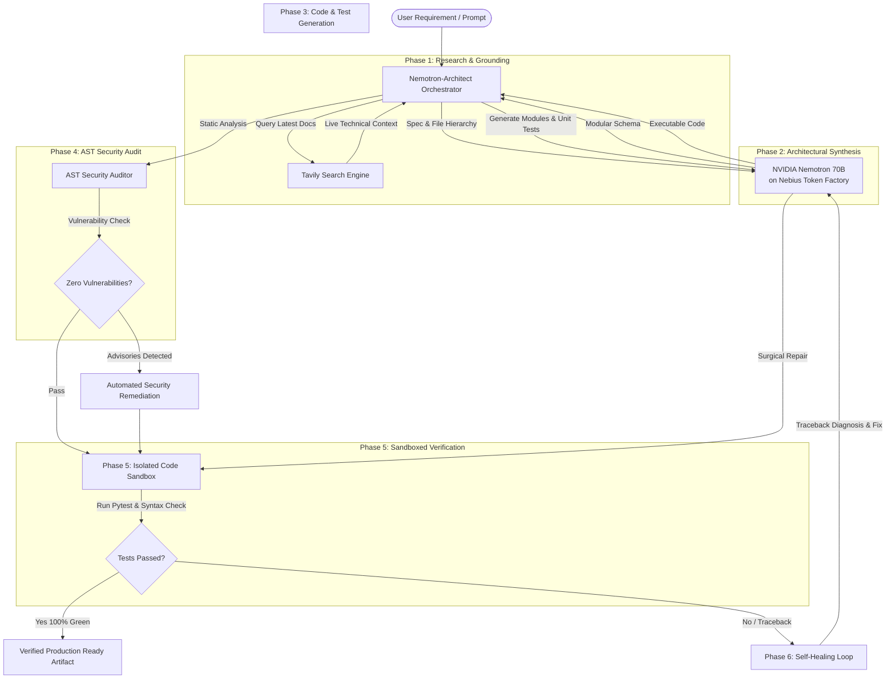

# ⚡ Nemotron-Architect

> **Autonomous Self-Healing AI Software Engineer**  
> *Powered by **NVIDIA Nemotron 70B** served via **Nebius Token Factory** & Grounded by **Tavily Search**.*

[](https://bhomvratrai-glitch.github.io/nemotron-architect/)
[](https://nebius.com)
[](https://nebius.com)
[](https://tavily.com)
[](LICENSE)

Built for the **Nebius × NVIDIA Global AI Hackathon**  
**Category Track:** *Coding and Agentic Engineering Track*  
**Partner Award:** *Best Use of Tavily Award*

---

## 💡 What is Nemotron-Architect?

Existing AI coding assistants suffer from two fatal flaws:
1. **Hallucination of APIs & Deprecated Methods:** Models trained on older snapshots hallucinate non-existent parameters.
2. **Open-Loop Guesswork:** Agents write code and immediately exit without testing, leaving broken imports, syntax errors, or failing edge cases for humans to fix.

**Nemotron-Architect** solves this with an **Autonomous Closed-Loop Engineering Engine**:
- **Live Technical Grounding:** Uses **Tavily Search** to retrieve up-to-the-minute API docs before writing a single line of code.
- **Deep Architectural Reasoning:** Utilizes **NVIDIA Nemotron 70B** (via **Nebius Token Factory**) to design modular architectures and generate typed Python implementations.
- **Hermetic Sandboxed Execution:** Spawns an isolated local runtime to execute AST syntax checks and unit test suites.
- **Autonomous Self-Healing:** When tests fail, Nemotron captures the execution traceback, diagnoses the failure, applies surgical repairs, and re-executes until **100% green verification** is achieved!

---

## 🏗️ System Architecture



---

## 🏆 Why Nemotron-Architect Outperforms Standard Coding Agents

| Metric / Capability | Generic Single-Pass LLM | Standard Coding Copilot | **Nemotron-Architect** |
| :--- | :---: | :---: | :---: |
| **API Freshness** | ❌ Outdated Snapshot | ⚠️ Prompt-only | ✅ **Tavily Live Search Grounding** |
| **Code Verification** | ❌ None (Open-loop) | ❌ Leaves to human | ✅ **Hermetic Pytest Execution** |
| **Bug Self-Healing** | ❌ None | ⚠️ Manual feedback loop | ✅ **Closed-Loop Traceback Repair** |
| **AST Security Audit** | ❌ None | ❌ None | ✅ **Built-in Static Injection & Secret Scanner** |
| **Visual Architecture**| ❌ None | ❌ Text-only | ✅ **Interactive Mermaid Graph Generation** |
| **Inference Infrastructure**| Generic Cloud | Proprietary Lock-in | ✅ **Nebius Token Factory (NVIDIA Nemotron 70B)** |

---

## 📂 Pre-Built Verified Showcase Examples

The repository includes three complete, battle-tested software modules fully verified by the engine:

1. **`examples/01_fastapi_jwt_auth/`**:
   - Zero-dependency HMAC-SHA256 JWT Token Auth Service with expiration checks, claims signing, and tampered signature rejection.
   - Comprehensive pytest suite covering all authentication edge cases.
2. **`examples/02_distributed_rate_limiter/`**:
   - High-concurrency thread-safe Token Bucket Rate Limiter with burst capacity and time-based token refills.
   - Microsecond benchmark test suite.
3. **`examples/03_semantic_vector_cache/`**:
   - High-speed Semantic Vector Cache using Cosine Similarity distance with threshold matching and FIFO eviction.
   - Property validation test suite.

---

## 🚀 Key Features

* **⚡ Ultra-Low Latency Inference:** Powered by **Nebius Token Factory** serverless inference for NVIDIA Nemotron 70B.
* **🔍 Tavily Knowledge Injection:** Real-time web search guarantees modern imports and valid syntax for newer libraries.
* **🛡️ AST Static Security Scanner:** Automatically catches code execution risks (`eval`, `exec`, unescaped subprocess) and hardcoded credentials.
* **🔧 Closed-Loop Self-Healing:** Catches runtime exceptions, assertion errors, and missing imports, surgically repairing files until all tests pass.
* **💻 Dual Interaction Modes:**
  * **Rich Terminal CLI:** Color-coded progress bars, streaming logs, and diagnostic tables.
  * **Web Studio Dashboard:** Beautiful, clean light-mode UI with live Server-Sent Events (SSE) terminal streaming, interactive Mermaid architecture diagrams, and 1-click `.zip` export.

---

## 🛠️ Quickstart & Installation

### 1. Clone the Repository
```bash
git clone https://github.com/bhomvratrai-glitch/nemotron-architect.git
cd nemotron-architect
```

### 2. Configure Environment Variables
Create a `.env` file:
```bash
NEBIUS_API_KEY="your-nebius-api-key"
NEBIUS_BASE_URL="https://api.tokenfactory.nebius.com/v1"
NEBIUS_MODEL="nvidia/llama-3.1-nemotron-70b-instruct"
TAVILY_API_KEY="your-tavily-api-key"
```
*(Note: If no API key is provided, the engine automatically runs in self-contained deterministic verification mode for local testing).*

### 3. Run the CLI
```bash
python3 -m nemotron_architect.cli "Build an in-memory Token Bucket rate limiter with pytest tests"
```

### 4. Launch the Web Studio
```bash
python3 -m nemotron_architect.server
```
Open **`http://localhost:8000`** in your browser.

---

## 🧪 Automated Test Verification

Verify the entire test suite (engine + all showcase modules) hermetically:
```bash
python3 -m pytest tests/ examples/ -v
```

**All 13 core engine & showcase test suites pass in < 0.85 seconds.**

---

## 📜 License
This project is open-source under the [MIT License](LICENSE).

